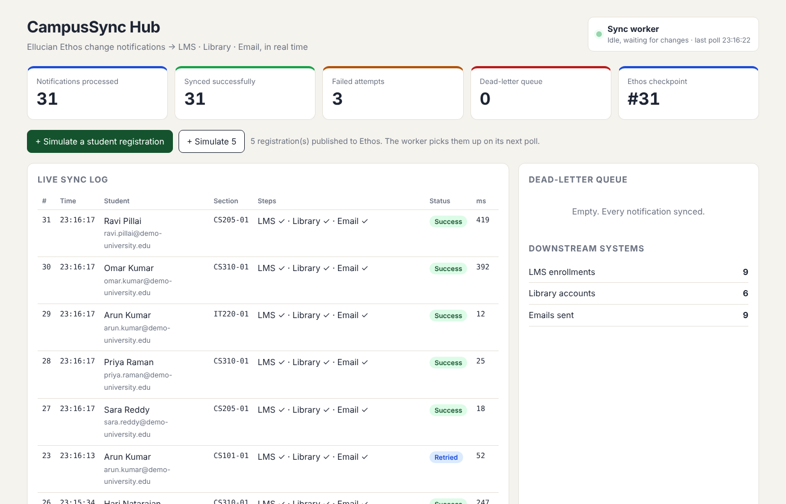

# CampusSync Hub

**Event-driven university integration platform built on the Ellucian Ethos integration pattern (.NET 8).**

When a student registers for a course, the university's Student Information System publishes a change notification to Ellucian Ethos. CampusSync Hub consumes that notification and, within seconds and with no manual work:

1. Enrolls the student in the matching **LMS** course
2. Creates their **library** account
3. Sends a confirmation **email**
4. Shows everything live on a **Blazor dashboard**, with failed syncs held in a dead-letter queue for one-click replay



## Architecture

```
┌──────────────────┐   POST /auth (API key → JWT)    ┌──────────────────────────────┐
│  Mock Ethos API  │◀────────────────────────────────│        CampusSync Hub        │
│  :5101           │   GET /consume?lastProcessedID  │  :5000                       │
│                  │────────change notifications────▶│  SyncWorker (BackgroundSvc)  │
│  persons         │   GET /api/persons/{id}         │    ↓                         │
│  courses         │   GET /api/sections/{id}        │  RegistrationSyncProcessor   │
│  sections        │                                 │    ↓  (Polly resilience)     │
│  section-        │                                 │  ┌────────────────────────┐  │
│  registrations   │                                 │  │ SQLite: sync log,      │  │
└──────────────────┘                                 │  │ dead letters,          │  │
                                                     │  │ idempotency, checkpoint│  │
┌──────────────────┐   POST /lms/enrollments         │  └────────────────────────┘  │
│ Target Systems   │◀────────────────────────────────│  Blazor Server dashboard     │
│ :5201  LMS       │   POST /library/accounts        │  (live via SignalR)          │
│        Library   │   POST /notify/email            └──────────────────────────────┘
│        Email     │
└──────────────────┘
```

| Project | Role |
|---|---|
| `src/MockEthos.Api` | Mock of Ellucian Ethos Integration: API-key → JWT auth, EEDM-style resources, `/consume` change-notification feed |
| `src/TargetSystems.Api` | Mock LMS, library and email gateway. `CHAOS_RATE` makes a share of calls fail with 503 |
| `src/CampusSync.Hub` | The product: sync worker, processor, resilience, persistence, Blazor dashboard, JSON API |
| `tests/CampusSync.Tests` | xUnit tests for the sync engine |

## Engineering highlights

- **Ethos auth flow**: exchanges the API key for a short-lived JWT, caches it, refreshes before expiry (thread-safe with `SemaphoreSlim`).
- **Checkpointed consumption**: the last processed notification id is persisted after every message, so a restart resumes exactly where it stopped.
- **Idempotency**: every notification id is recorded once. At-least-once delivery plus idempotent processing gives an exactly-once effect; the LMS endpoint is idempotent too.
- **Resilience**: `Microsoft.Extensions.Http.Resilience` (Polly v8) with exponential back-off and jitter, per-attempt and total timeouts, and a circuit breaker. In the demo, 30% of downstream calls fail and every registration still syncs.
- **Dead-letter queue**: anything that fails after all retries is stored with its payload and error, and can be replayed from the dashboard or `POST /api/dead-letters/{id}/retry`.
- **Live UI**: the worker raises an in-process event, and Blazor Server pushes the update to the browser over SignalR. No page refresh needed.
- **Swappable**: to point at a real Ethos tenant, change `Ethos:BaseUrl` and `Ethos:ApiKey` in config. The client already speaks the Ethos contract (`/auth`, `/consume`, `/api/{resource}`, versioned `Accept` header).

## Run it

### Option A: .NET 8 SDK (three terminals)

```bash
dotnet run --project src/MockEthos.Api      --urls http://localhost:5101
CHAOS_RATE=0.3 dotnet run --project src/TargetSystems.Api --urls http://localhost:5201   # PowerShell: $env:CHAOS_RATE="0.3"
dotnet run --project src/CampusSync.Hub     --urls http://localhost:5000
```

Open **http://localhost:5000** and press **"+ Simulate a student registration"**.

### Option B: Docker

```bash
docker compose up --build
```

### Tests

```bash
dotnet test
```

## Demo script (2 minutes, good for a LinkedIn video)

1. Open the dashboard. The 5 seeded registrations are already synced.
2. Click **Simulate 5**. Rows appear live, even though 30% of downstream calls are failing behind the scenes (Polly retries absorb it).
3. Stop `TargetSystems.Api` (outage), click **Simulate a student registration**. After the retries are exhausted it lands in the **dead-letter queue**.
4. Start `TargetSystems.Api` again and click **Retry**. The row turns blue (**Retried**) and the queue empties.

## API reference

| Service | Endpoint | Purpose |
|---|---|---|
| Ethos | `POST /auth` | `Authorization: Bearer <api-key>` → JWT (plain text) |
| Ethos | `GET /api/{persons\|courses\|sections\|section-registrations}[/{id}]` | Resources |
| Ethos | `GET /consume?lastProcessedID=&limit=` | Change notifications |
| Ethos | `POST /simulate/registration` | Demo helper, not part of real Ethos |
| Hub | `GET /api/stats`, `GET /api/logs` | Monitoring |
| Hub | `POST /api/dead-letters/{id}/retry` | Replay a failed notification |

## Notes

- Mock data and endpoint shapes follow the published Ethos pattern but are simplified. Check the Ellucian developer documentation before integrating with a real tenant.
- Downstream mocks keep data in memory, so their counters reset when they restart. The Hub's own history lives in `campussync.db`.

**Tech:** .NET 8 · ASP.NET Core Minimal APIs · Blazor Server · SignalR · EF Core + SQLite · Polly v8 · JWT · xUnit · Docker
